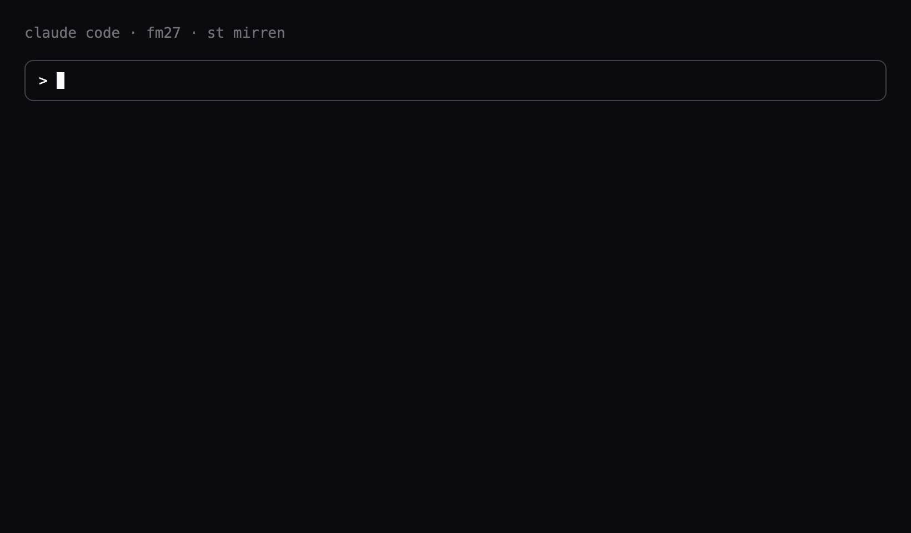

<div align="center">

# mezzala

i love football manager. i hate scrolling a 40,000-player search screen to find one decent centre back on a st mirren budget.
so i made an mcp server that reads my save and does the scouting for me. i ask claude, it asks mezzala, mezzala reads the save.



</div>

## what it answers

| tool | answers |
| --- | --- |
| `find_players` | searches the whole save: wonderkids under a price, undervalued players, players too good for their league, reserves stuck at bigger clubs, low release clauses, free agents, the best players in the world |
| `squad` | everyone available, loanees included, with natural and accomplished positions |
| `player_profile` | one player in full, or two side by side: attributes, hidden attributes, personality, feet, traits, fitness, injuries, this season's stats and what's changed |
| `compare_formations` | which formation your squad fits best, with the eleven for each |
| `shortlist` | a realistic shortlist, one target per weak position, within your transfer budget and wage room |
| `wage_review` | your wage bill, who's overpaid, and who could go without weakening the squad |
| `development_plan` | which youngsters are ready, who to loan out, and who to focus on |
| `training_plan` | one of your players' position to train for, additional focus, intensity, traits to learn or unlearn, and who should mentor him |
| `dressing_room` | who should captain the club, and who could unsettle the squad or push for a move |
| `fitness` | who's injured or banned, injury-prone starters, and who's low on condition or match sharpness |
| `staff_review` | your backroom staff: the best coach in each training area, scouting and medical, and which areas need a hire |
| `league_comparison` | where your squad ranks in your league, overall and position by position |
| `what_changed` | what's changed since your last save: squad, budget, contracts, values, new regens, big transfers |
| `watch_player`, `watchlist` | mezzala's own shortlist, flagging targets that got cheaper |
| `development_check` | wonderkids who aren't developing as expected, and players in decline |
| `squad_progress` | your squad now against when you started using mezzala |
| `next_job` | open manager jobs, biggest club first, with each club's squad and money |
| `league_values` | which leagues have the cheapest players for their level |
| `relegated_clubs` | clubs that dropped a league since an earlier snapshot, and who's worth signing there |
| `squad_profile` | your eleven's attribute strengths and weaknesses against the league, for tactics |
| `positional_fit` | starters whose attributes suit another position better |
| `next_opponent` | your next opponent: likely shape, best eleven, key players, how they compare, recent form, and who's missing on both sides |
| `squad_gaps` | your eleven for a formation, plus where you're thin, ageing, losing players, weak, or have no young successor coming through |
| `find_replacement` | who plays like a player you're losing, fits your budget, and would actually sign |
| `risers` | who's improving fastest: transfer targets, your own players, or ones you sold too early |
| `sell_high` | which of your players to cash in on before their value drops |
| `contract_watch` | your contracts and loans running out, plus free agents and pre-contract targets who'd start for you |
| `regen_intake` | new regens since an earlier snapshot, best potential first, and which clubs produce them |
| `snapshot` | reads the save now and lists the dates it has history for |

so you can ask things like:

- "find me the best wonderkids under £5m"
- "who's too good for the league they play in?"
- "who replaces gogić for under £1m?"
- "which of my players should i sell this window?"
- "build me a shortlist within my budget"
- "how do we compare with the rest of the league?"
- "anyone out of contract next summer who'd walk into my team?"
- "which of this year's regens are any good?"

## how it works

every call checks your save file. if it's changed, mezzala reads it with [fmsave](https://github.com/rhiever/fmsave) and keeps a snapshot for that in-game date. growth, falling values and new regens all come from comparing snapshots.

on day one there's only one snapshot, so `risers` projects next season's growth from age, the gap to potential, professionalism, determination and ambition. once you've saved later in the season it switches to real numbers. `regen_intake` needs a youth intake after your first snapshot before it has anything to show.

suggestions only include players whose reputation is close to your club's, so st mirren doesn't get told to sign benzema. pass `within_reach: false` if you want to dream.

## install it

you need football manager 27 and claude. paste this into claude, in the desktop app or claude code:

> install the latest version of this mcp: https://github.com/j4ckwinter/mezzala

then load your career in fm, save it, and ask claude "using mezzala, show me my squad". mezzala reads whichever fm27 save was written most recently, so save in fm whenever you want it to see what's changed.

<details>
<summary>install it yourself</summary>

**claude desktop app:** download `mezzala.mcpb` from the [latest release](https://github.com/j4ckwinter/mezzala/releases/latest) and open it. claude asks before installing. the first question takes a minute while it sets up and reads your save. to update, open the new `mezzala.mcpb`. to remove it, go to settings → extensions.

**claude code:** you need [uv](https://docs.astral.sh/uv/getting-started/installation/), which brings its own python. get it from homebrew on a mac (`brew install uv`) or winget on windows (`winget install --id=astral-sh.uv -e`). then:

```sh
uv tool install git+https://github.com/j4ckwinter/mezzala
claude mcp add --scope user mezzala -- "$(uv tool dir --bin)/mezzala"
```

on windows, the second line ends in `\mezzala.exe` instead of `/mezzala`. to stick to one career rather than the newest save, add `--save "/path/to/career.fm"` to the end. update with `uv tool upgrade mezzala`, then restart claude. remove it with `claude mcp remove --scope user mezzala` and `uv tool uninstall mezzala`.

**fog of war:** by default mezzala sees everything, hidden ca and pa included. switch fog of war on and it shows ability as stars and keeps hidden attributes and personality numbers out of its answers. its picks still use the real numbers, like a scouting team that's never wrong. in the desktop app it's a setting on the extension (settings → extensions → mezzala). in claude code, add `--fog-of-war on` to the end of the `claude mcp add` line.

**where it looks:** fm's usual save folders, `~/Library/Application Support/Sports Interactive/Football Manager 27/games` on a mac and `Documents\Sports Interactive\Football Manager 27\games` on windows (onedrive's too). snapshots live in `~/.mezzala`.

**if it doesn't work:** check mezzala is switched on in settings → extensions, and start your question with "using mezzala". "no .fm saves found" means you haven't saved your career yet, or your saves are somewhere unusual, so use `--save`.

</details>

## what it can't do

- fees are fm's transfer values. asking prices aren't in the save.
- it reads the shape of the first-team tactic you've saved, but not your roles or instructions, so tactical advice comes from your players' attributes. fm only stores a tactic once you've set one up, and wing-back positions can't be read yet, so without a readable tactic it uses 4-3-3. you can always tell claude your formation (4-3-3, 4-2-3-1, 4-4-2, 4-4-2 diamond, 3-5-2 or 3-4-3).
- `compare_formations` ranks shapes by how well your players fit them, not by how the match engine rates them. it treats wingers and wide midfielders as the same position, and full backs and wing backs too, so 4-1-4-1 and 5-3-2 would tie with 4-3-3 and 3-5-2.
- it sees everything, including hidden ca and pa, unless you switch fog of war on. even then it can't know which players your scouts have actually seen.
- the save doesn't name leagues, and leagues that aren't loaded in your save don't count, so "above league level" only covers players in loaded leagues.
- a loan player counts at the club he's on loan to, so `reserves_only` and `bigger_clubs_only` don't find a big club's youngsters out on loan.
- fmsave has only verified fm27 build `27.0.0+2486695`. my save is on 27.1.1 and reads fine, but treat the numbers as fmsave's best effort.

## develop

you need python 3.12 or newer.

```sh
git clone https://github.com/j4ckwinter/mezzala.git
cd mezzala
python3 -m venv .venv
.venv/bin/pip install -e ".[dev]"
.venv/bin/ruff format --check src tests && .venv/bin/ruff check src tests
.venv/bin/pyright
.venv/bin/pytest -q
```

to have claude run your checkout instead of the installed copy, point the command at `.venv/bin/mezzala`.
[AGENTS.md](AGENTS.md) has the rest.
